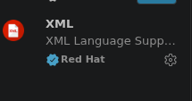
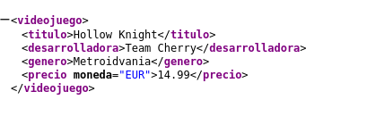

# Sesión 1. Introducción práctica a XML

## 1. Preparación del entorno

He instalado la extensión **XML de Red Hat** para disponer de resaltado,
formateo y detección de errores en Visual Studio Code.



## 2. Investigación inicial

**¿Qué significa XML?**

XML significa Lenguaje de marcado extensible. Es formato estándar que sirve para estructurar, almacenar e intercambiar datos de forma organizada.


**¿Por qué se considera un lenguaje extensible?**

Se considera extensible porque no tiene etiquetas predefinidas,XML te permite crear el nombre que quieras de etiqueta.


**¿Cuál es la diferencia principal entre XML y HTML?**

El XML tiene como objetivo


**Escribe tres usos reales de XML.**


¿Qué significa que un documento sea legible por personas y máquinas?


¿Por qué XML no debe considerarse automáticamente una base de datos?


### Fuentes consultadas

- [Título de la primera fuente](URL)
- [Título de la segunda fuente](URL)


## 3. Mi primer documento XML



```xml
<videojuego>
<titulo>Hollow Knight</titulo>
<desarrolladora>Team Cherry</desarrolladora>
<genero>Metroidvania</genero>
<precio moneda="EUR">14.99</precio>
</videojuego>
```
```
Elemento raíz + polladas varias
