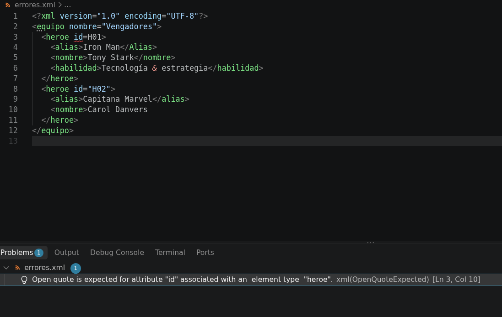
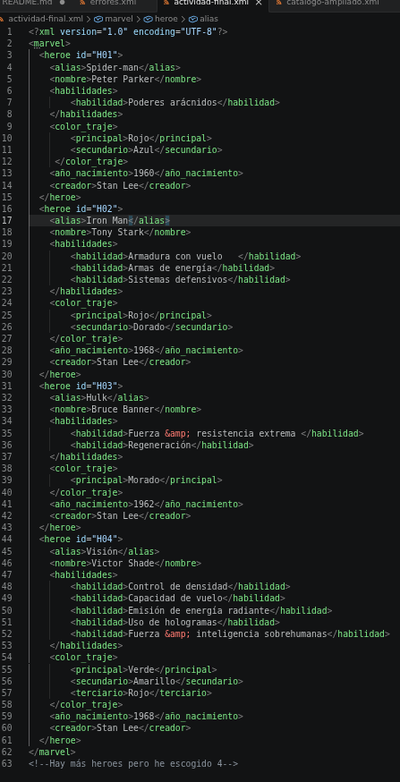

# Sesión 1. Introducción práctica a XML

## 1. Preparación del entorno

He instalado la extensión **XML de Red Hat** para disponer de resaltado,
formateo y detección de errores en Visual Studio Code.


## 2. Investigación inicial

***¿Qué significa XML?***

XML significa Lenguaje de marcado extensible. Es formato estándar que sirve para estructurar, almacenar e intercambiar datos de forma organizada.


***¿Por qué se considera un lenguaje extensible?***

Se considera extensible porque no tiene etiquetas predefinidas,XML te permite crear el nombre que quieras de etiqueta (donde se describe el contenido).Aunque es susceptible a los errores incluso diferenciando mayúsculas y minúsculas.


***¿Cuál es la diferencia principal entre XML y HTML?***

El HTML dicta como se ve la información y el XML dicta como es la información y su estructura.


***Escribe tres usos reales de XML.***

- **Formatos de documentos**: Word, Excel y PorwerPoint almacenan el contenido, estilo y metadatos en archivo XML.

- **Intercambio de datos en servicios web**: los feeds de noticias y podcasts se destribuyen en XML (RRS/Atom).

- **Archivo de configuración**: Muchos programas guardan su configuración en XML como Android porque es jerárquico, fácil de editar y soporta comentarios.


***¿Qué significa que un documento sea legible por personas y máquinas?***

Es la capacidad de que los datos puedan ser leídos de forma natural por el ser humano como por la máquina.

***¿Por qué XML no debe considerarse automáticamente una base de datos?***

XML es adecuado para datos semiestructuras por lo que su uso en base de datos puede requerir un procesamiento adicional y puede no ser compatible el resto de procesos del negocio. 

### Fuentes consultadas

- [Introducción a XML](https://developer.mozilla.org/es/docs/Web/XML/Guides/XML_introduction)
- [Tutoriales Programación Ya](https://www.tutorialesprogramacionya.com/xmlya/tema17.html)
- [XML vs HTML: Conoce la diferecia entre estos lenguajes de marca](https://kinsta.com/es/blog/xml-vs-html/)

## 3. Mi primer documento XML


```xml
<videojuego>
<titulo>Hollow Knight</titulo>
<desarrolladora>Team Cherry</desarrolladora>
<genero>Metroidvania</genero>
<precio moneda="EUR">14.99</precio>
</videojuego>
```

- Identifica el elemento raíz: videojuego.
- Enumera todos los elementos: videojuego,titulo,desarrolladora,genero,precio.
- Identifica el atributo y su valor:
Atributo: moneda. Valor:"EUR".
- Explica qué relación existe entre videojuego y titulo: videojuego es el elemento padre y titulo es elemento hijo.
- Indica qué elementos son hermanos: titulo,desarrolladora,genero,precio.

## 4. Ampliación del catálogo

```XML
<?xml version="1.0" encoding="UTF-8"?>
<catalogo actualizado="2026-09-29">
  <videojuego id="V001" disponible="true">
    <titulo>Hollow Knight</titulo>
    <desarrolladora>Team Cherry</desarrolladora>
    <plataformas>
      <plataforma>PC</plataforma>
      <plataforma>Switch</plataforma>
    </plataformas>
    <precio moneda="EUR">14.99</precio>
  </videojuego>

  <videojuego id="V002" disponible="true">
    <titulo>Celeste</titulo>
    <desarrolladora>Extremely OK Games</desarrolladora>
    <plataformas>
      <plataforma>PC</plataforma>
      <plataforma>Switch</plataforma>
    </plataformas>
    <precio moneda="EUR">19.99</precio>
  </videojuego>

<!-- Juegos añadidos por el alumno -->
  <videojuego id="V003" disponible="true">
    <titulo>Marvel's Wolwerine</titulo>
    <desarrolladora>Insomniac Games</desarrolladora>
    <plataformas>
      <plataforma>PS5</plataforma>
    </plataformas>
    <precio moneda="EUR">79.99</precio>
  </videojuego>

  <videojuego id="V004" disponible="true">
    <titulo>Gears of War: E-Day</titulo>
    <desarrolladora>The Coalition</desarrolladora>
    <plataformas>
      <plataforma>PC</plataforma>
      <plataforma>Xbox Serie X|S</plataforma>
    </plataformas>
    <precio moneda="EUR">62.27</precio>
  </videojuego>

  <videojuego id="V005" disponible="true">
    <titulo>Onimusha: Way of the Sword</titulo>
    <desarrolladora>Capcom</desarrolladora>
    <plataformas>
      <plataforma>PS5</plataforma>
      <plataforma>Xbox Serie X|S</plataforma>
      <plataforma>Nintendo Switch 2</plataforma>
      <plataforma>PC</plataforma>
    </plataformas>
    <precio moneda="EUR">69.99</precio>
  </videojuego>

  <videojuego id="V006" disponible="true">
    <titulo>The Blood of Dawnwalker</titulo>
    <desarrolladora>Rebel Wolves</desarrolladora>
    <plataformas>
      <plataforma>PC</plataforma>
      <plataforma>Xbox Serie X|S</plataforma>
      <plataforma>PS5</plataforma>
    </plataformas>
    <precio moneda="EUR">69.99</precio>
  </videojuego>


  <videojuego id="V007" disponible="true">
    <titulo>007 First Light</titulo>
    <desarrolladora>IO Interactive</desarrolladora>
    <plataformas>
      <plataforma>PC</plataforma>
      <plataforma>Xbox Serie X|S</plataforma>
      <plataforma>PS5</plataforma>
    </plataformas>
    <precio moneda="EUR">69.99</precio>
  </videojuego>

  <videojuego id="V008" disponible="true">
    <titulo>Resonance: A Plague Tale Legacy</titulo>
    <desarrolladora>Asobo Studio</desarrolladora>
    <plataformas>
      <plataforma>PC</plataforma>
      <plataforma>Xbox Serie X|S</plataforma>
      <plataforma>PS5</plataforma>
    </plataformas>
    <precio moneda="EUR">59.99</precio>
  </videojuego>


  <videojuego id="V009" disponible="true">
    <titulo>The Legend of Zelda: Ocarina of Time Remake</titulo>
    <desarrolladora>Nintendo</desarrolladora>
    <plataformas>
      <plataforma>Nintendo Switch 2</plataforma>
    </plataformas>
    <precio moneda="EUR">59.99</precio>
  </videojuego>


  <videojuego id="V0010" disponible="true">
    <titulo>Football Manager 27</titulo>
    <desarrolladora>Sports Interactive</desarrolladora>
    <plataformas>
      <plataforma>PC</plataforma>
      <plataforma>Xbox Serie X|S</plataforma>
      <plataforma>PS5</plataforma>
      <plataforma>Mac</plataforma>
      <plataforma>móviles vía Netflix</plataforma>
    </plataformas>
    <precio moneda="EUR">49.99</precio>
  </videojuego> 

   <videojuego id="V0011" disponible="true">
    <titulo>Safety Firts!</titulo>
    <desarrolladora>JCO</desarrolladora>
    <plataformas>
      <plataforma>PC</plataforma>
      <plataforma>Nintendo Switch</plataforma>
    </plataformas>
    <precio moneda="EUR">14.99</precio>
  </videojuego>

   <videojuego id="V0012" disponible="true">
    <titulo>Warcraft III Reforged: Reino olvidado</titulo>
    <desarrolladora>Blizzard Entertainment</desarrolladora>
    <plataformas>
      <plataforma>PC</plataforma>
      <plataforma>Mac</plataforma>
    </plataformas>
    <precio moneda="EUR">29.99</precio>
  </videojuego>
</catalogo>
```

Plataformas funciona como contedor porque contiene otros elementos dentro de ella, esto nos permite proporcionar más de una plataforma para cada videojuego.

el número de elementos videojuegos es 12 y en total tenemos 30 elementos plataforma.

Hemos tenido que modificar las id para que sean propias para cada videojuego, cambiado los titulos, la desarrolladora y el precio en cada uno y aparte añadido o quitado elementos plataforma para cada una de ellas.

## 5. Laboratorio de errores



| Error detectado | Regla que incumple | Corrección realizada |
|---|---|---|
| id=H01 | valor del atributo sin comillas | id="H01" |
| \<alias>\</Alias> | XML distingue entre mayúscula y minúsculas por lo que no se está cerrando elemento alias | \<alias>\</alias> |
| & | Este símobolo en XML inicia una entidad,hay que escaparlo para que XML no lo interprete así | \&amp; |
| \<nombre> | El elemento no está cerrado | \<nombre>\</nombre> | 

> errores.xml ya no marca errores pero tenemos que tener en cuenta que para el segundo héroe no tenemos elemento habilidad, se podría quedar así mientras este elemento no lo marquemos como requerido.

## 6. Actividad final independiente

He elegido el tema Marvel específicamente los heroes, el documento representa los datos principales de estos.

```
marvel
'-->heroe
     '-->alias
     '-->nombre
     '-->habilidades
         '-->habilidad
     '-->color_traje
         '-->principal
         '-->secundario
         '-->terciario
     '-->año_nacimiento
     '-->creador
 
```

```xml
<?xml version="1.0" encoding="UTF-8"?>
<marvel>
  <heroe id="H01">
    <alias>Spider-man</alias>
    <nombre>Peter Parker</nombre>
    <habilidades>
        <habilidad>Poderes arácnidos</habilidad>
    </habilidades>
    <color_traje>
        <principal>Rojo</principal>
        <secundario>Azul</secundario>
     </color_traje>
    <año_nacimiento>1960</año_nacimiento>
    <creador>Stan Lee</creador>
  </heroe>
  <heroe id="H02">
    <alias>Iron Man</alias>
    <nombre>Tony Stark</nombre>
    <habilidades>
        <habilidad>Armadura con vuelo   </habilidad>
        <habilidad>Armas de energía</habilidad>
        <habilidad>Sistemas defensivos</habilidad>
    </habilidades>   
    <color_traje>
        <principal>Rojo</principal>
        <secundario>Dorado</secundario>
    </color_traje>
    <año_nacimiento>1968</año_nacimiento>
    <creador>Stan Lee</creador>
  </heroe>
  <heroe id="H03">
    <alias>Hulk</alias>
    <nombre>Bruce Banner</nombre>
    <habilidades>
        <habilidad>Fuerza &amp; resistencia extrema </habilidad>
        <habilidad>Regeneración</habilidad>
    </habilidades> 
    <color_traje>
        <principal>Morado</principal>
    </color_traje>
    <año_nacimiento>1962</año_nacimiento>
    <creador>Stan Lee</creador>
  </heroe>
  <heroe id="H04">
    <alias>Visión</alias>
    <nombre>Victor Shade</nombre>
    <habilidades>
        <habilidad>Control de densidad</habilidad>
        <habilidad>Capacidad de vuelo</habilidad>
        <habilidad>Emisión de energía radiante</habilidad>
        <habilidad>Uso de hologramas</habilidad>
        <habilidad>Fuerza &amp; inteligencia sobrehumanas</habilidad>
    </habilidades>
    <color_traje>
        <principal>Verde</principal>
        <secundario>Amarillo</secundario>
        <terciario>Rojo</terciario>
    </color_traje>
    <año_nacimiento>1968</año_nacimiento>
    <creador>Stan Lee</creador>
  </heroe>
</marvel>
<!--Hay más heroes pero he escogido 4-->
```

| Dato | Elemento o atributo | Justificación |
|---|---|---|
| poderes | \<habilidad> | había en varios héroes más de una habilidad |
| años | \<año_nacimiento> | año en el que se creó el personaje |
| morado | \<color_traje>\<principal> | Hulk es principalmente verde pero tomo el color de sus pantalones como color principal del traje|
| \<terciario> | elemento opcional | Visión tiene 3 colores en su traje por lo que tuve que crear un elemento hijo más en \<color_traje>




