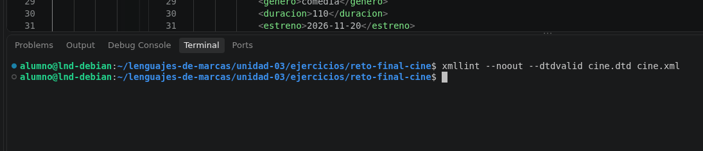
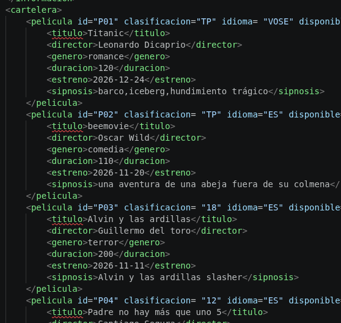
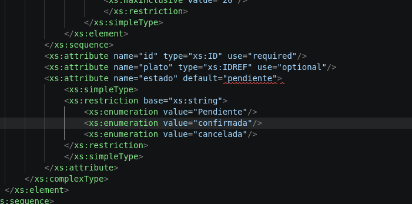

# ENUNCIADO:

El cine Cinépolis quiere organizar digitalmente su cartelera y sus reservas. Para ello, necesita registrar las películas que ofrece, las salas con sus butacas, las sesiones programadas y las entradas reservadas por los clientes.

Tu misión es crear los archivos cine.xml, cine.dtd y cine.xsd, de forma que el mismo XML sea válido tanto con el DTD como con el XSD.

No se proporciona código de partida: deberás decidir cómo organizar los elementos y atributos respetando los requisitos siguientes.

## Información que debe contener el XML
El elemento raíz será "cine" y tendrá un atributo id obligatorio. En su interior aparecerán, en este orden, los bloques que se describen a continuación.

### Información del cine
Incluye el nombre, la dirección, la localidad y el teléfono de contacto.

### Cartelera
Cada película debe contener:

Un identificador único obligatorio (id).
Título, director, género, duración en minutos y fecha de estreno.
Sinopsis, de carácter opcional.
Los atributos clasificacion (TP, 7, 12, 16 o 18), idioma (ES, VOSE o VO) y disponible (booleano, con valor predeterminado true).
2.3. Salas y butacas
Cada sala debe contener:

Un identificador único obligatorio (id).
Nombre o número de la sala y su capacidad.
Un listado de butacas.
Cada butaca debe disponer de:

Un identificador único obligatorio (id).
Una fila identificada por una letra y un número de asiento.
Un atributo tipo con uno de estos valores: normal, premium o adaptada.
### Sesiones
Cada sesión debe contener:

Un identificador único obligatorio (id).
Fecha de proyección, hora de inicio y precio de entrada.
Un atributo obligatorio pelicula que haga referencia al identificador de una película.
Un atributo obligatorio sala que haga referencia al identificador de una sala.
En el precio, un atributo moneda cuyo valor será EUR.
### Reservas
Cada reserva debe contener:

Un identificador único obligatorio (id).
Nombre y correo electrónico del cliente.
Fecha de la reserva.
Una o varias entradas.
Un atributo obligatorio sesion que haga referencia al identificador de una sesión.
Un atributo estado con los valores pendiente, confirmada o cancelada.
Cada entrada debe indicar:

La butaca reservada mediante un atributo de referencia al identificador de una butaca existente.
Un atributo tipo que podrá ser general, infantil o reducida.

## Comando para las validaciones: 

 Para validar dtd
```bash
xmllint --noout --dtdvalid cine.dtd cine.xml
```



En la captura no marca ningún fallo por lo que se da por supuesto que está bien la comprobación.


Para validar xsd
```bash
xmllint --noout --schema cine.xsd cine.xml
```


En esta captura nos marca directamente que cine.xml está validado.

## Errores .dtd y .xsd



Borré en el .dtd el elemento hijo titulo dentro del elemento padre película y me los marcó porque no estaban definidos en mi dtd.




Cambié el valor de pendiente por Pendiente y me marcó el fallo porque por defecto pendiente estaban en minúsculas y es subceptibles a mayúsculas y minúsculas.

## Diferencia entre dtd y xsd 

DTD es más simple y limitado. XSD es más moderno y completo, ofrece una validación más precisa. 