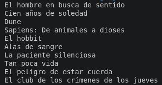
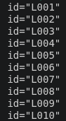
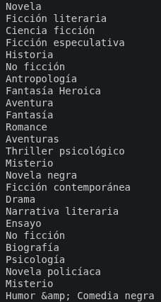
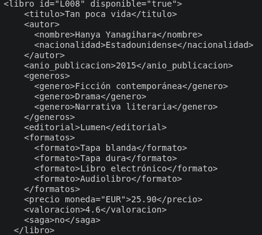
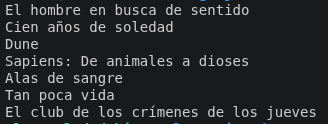

# Consultas XPath obligatorias

1. Seleccionar el elemento raíz <biblioteca>
```XML
<biblioteca actualizado="True">
  <libro id="L001" disponible="true">
    <titulo>El hombre en busca de sentido</titulo>
    <autor>
      <nombre>Viktor Frankl</nombre>
      <nacionalidad>Austriaco</nacionalidad>
    </autor>
    <anio_publicacion>1946</anio_publicacion>
    <generos>
      <genero>Biografía</genero>
      <genero>Psicología</genero>
      <genero>Filosofía</genero>
      <genero>Ensayo</genero>
    </generos>
    <editorial>Herder Editorial</editorial>
    <formatos>
      <formato>Tapa blanda</formato>
      <formato>Tapa dura</formato>
      <formato>Libro electrónico</formato>
      <formato>Audiolibro</formato>
    </formatos>
    <precio moneda="EUR">12.90</precio>
    <valoracion>4.8</valoracion>
    <saga>No</saga>
  </libro>
  <libro id="L002" disponible="true">
    <titulo>Cien años de soledad</titulo>
    <autor>
      <nombre>Gabriel García Márquez</nombre>
      <nacionalidad>Colombiano</nacionalidad>
    </autor>
    <anio_publicacion>1967</anio_publicacion>
    <generos>
      <genero>Realismo mágico</genero>
      <genero>Novela</genero>
      <genero>Ficción literaria</genero>
    </generos>
    <editorial>Literatura Random House</editorial>
    <formatos>
      <formato>Tapa blanda</formato>
      <formato>Edición ilustrada</formato>
      <formato>Libro electrónico</formato>
      <formato>Audiolibro</formato>
    </formatos>
    <precio moneda="EUR">21.90</precio>
    <valoracion>4.7</valoracion>
    <saga>No</saga>
  </libro>
  <libro id="L003" disponible="true">
    <titulo>Dune</titulo>
    <autor>
      <nombre>Frank Herbert</nombre>
      <nacionalidad>Estadounidense</nacionalidad>
    </autor>
    <anio_publicacion>1965</anio_publicacion>
    <generos>
      <genero>Ciencia ficción</genero>
      <genero>Ficción especulativa</genero>
    </generos>
    <editorial>Nova</editorial>
    <formatos>
      <formato>Tapa blanda</formato>
      <formato>Tapa dura</formato>
      <formato>Libro electrónico</formato>
      <formato>Audiolibro</formato>
    </formatos>
    <precio moneda="EUR">14.90</precio>
    <valoracion>4.6</valoracion>
    <saga>Las crónicas de Dune</saga>
  </libro>
  <libro id="L004" disponible="true">
    <titulo>Sapiens: De animales a dioses</titulo>
    <autor>
      <nombre>Yuval Noah Harari</nombre>
      <nacionalidad>Israelí</nacionalidad>
    </autor>
    <anio_publicacion>2011</anio_publicacion>
    <generos>
      <genero>Historia</genero>
      <genero>No ficción</genero>
      <genero>Antropología</genero>
    </generos>
    <editorial>Debate</editorial>
    <formatos>
      <formato>Tapa blanda</formato>
      <formato>Cómic / Novela gráfica</formato>
      <formato>Libro electrónico</formato>
      <formato>Audiolibro</formato>
    </formatos>
    <precio moneda="EUR">23.90</precio>
    <valoracion>4.7</valoracion>
    <saga>No</saga>
  </libro>
  <libro id="L005" disponible="False">
    <titulo>El hobbit</titulo>
    <autor>
      <nombre>J.R.R. Tolkien</nombre>
      <nacionalidad>Británico</nacionalidad>
    </autor>
    <anio_publicacion>1937</anio_publicacion>
    <generos>
      <genero>Fantasía Heroica</genero>
      <genero>Aventura</genero>
    </generos>
    <editorial>Minotauro</editorial>
    <formatos>
      <formato>Tapa blanda</formato>
      <formato>Tapa dura</formato>
      <formato>Edición ilustrada</formato>
      <formato>Libro electrónico</formato>
      <formato>Audiolibro</formato>
    </formatos>
    <precio moneda="EUR">21.00</precio>
    <valoracion>4.8</valoracion>
    <saga>Precuela de El Señor de los Anillos</saga>
  </libro>
  <libro id="L006" disponible="true">
    <titulo>Alas de sangre</titulo>
    <autor>
      <nombre>Rebecca Yarros</nombre>
      <nacionalidad>Estadounidense</nacionalidad>
    </autor>
    <anio_publicacion>2023</anio_publicacion>
    <generos>
      <genero>Fantasía</genero>
      <genero>Romance</genero>
      <genero>Aventuras</genero>
    </generos>
    <editorial>Editorial Planeta</editorial>
    <formatos>
      <formato>Tapa blanda</formato>
      <formato>Tapa dura con jaspeado</formato>
      <formato>Libro electrónico</formato>
      <formato>Audiolibro</formato>
    </formatos>
    <precio moneda="EUR">22.90</precio>
    <valoracion>4.7</valoracion>
    <saga>Serie Empíreo</saga>
  </libro>
  <libro id="L007" disponible="False">
    <titulo>La paciente silenciosa</titulo>
    <autor>
      <nombre>Alex Michaelides</nombre>
      <nacionalidad>Chipriota / Británico</nacionalidad>
    </autor>
    <anio_publicacion>2019</anio_publicacion>
    <generos>
      <genero>Thriller psicológico</genero>
      <genero>Misterio</genero>
      <genero>Novela negra</genero>
    </generos>
    <editorial>Alfaguara </editorial>
    <formatos>
      <formato>Tapa blanda</formato>
      <formato>Libro electrónico</formato>
      <formato>Audiolibro</formato>
    </formatos>
    <precio moneda="EUR">21.90</precio>
    <valoracion>4.4</valoracion>
    <saga>no</saga>
  </libro>
  <libro id="L008" disponible="true">
    <titulo>Tan poca vida</titulo>
    <autor>
      <nombre>Hanya Yanagihara</nombre>
      <nacionalidad>Estadounidense</nacionalidad>
    </autor>
    <anio_publicacion>2015</anio_publicacion>
    <generos>
      <genero>Ficción contemporánea</genero>
      <genero>Drama</genero>
      <genero>Narrativa literaria</genero>
    </generos>
    <editorial>Lumen</editorial>
    <formatos>
      <formato>Tapa blanda</formato>
      <formato>Tapa dura</formato>
      <formato>Libro electrónico</formato>
      <formato>Audiolibro</formato>
    </formatos>
    <precio moneda="EUR">25.90</precio>
    <valoracion>4.6</valoracion>
    <saga>no</saga>
  </libro>
  <libro id="L009" disponible="False">
    <titulo>El peligro de estar cuerda</titulo>
    <autor>
      <nombre>Rosa Montero</nombre>
      <nacionalidad>Española</nacionalidad>
    </autor>
    <anio_publicacion>2022</anio_publicacion>
    <generos>
      <genero>Ensayo</genero>
      <genero>No ficción</genero>
      <genero>Biografía</genero>
      <genero>Psicología</genero>
    </generos>
    <editorial>Seix Barral</editorial>
    <formatos>
      <formato>Tapa blanda</formato>
      <formato>Libro electrónico</formato>
      <formato>Audiolibro</formato>
    </formatos>
    <precio moneda="EUR">20.90</precio>
    <valoracion>4.5</valoracion>
    <saga>no</saga>
  </libro>
  <libro id="L010" disponible="true">
    <titulo>El club de los crímenes de los jueves</titulo>
    <autor>
      <nombre>Richard Osman</nombre>
      <nacionalidad>Británico</nacionalidad>
    </autor>
    <anio_publicacion>2020</anio_publicacion>
    <generos>
      <genero>Novela policíaca</genero>
      <genero>Misterio</genero>
      <genero>Humor &amp; Comedia negra</genero>
    </generos>
    <editorial>Espasa </editorial>
    <formatos>
      <formato>Tapa blanda</formato>
      <formato>Libro electrónico</formato>
      <formato>Audiolibro</formato>
    </formatos>
    <precio moneda="EUR">19.90</precio>
    <valoracion>4.3</valoracion>
    <saga>El club de los crímenes de los jueves</saga>
  </libro>
</biblioteca>
```
2. Seleccionar todos los libros.

```XML
<libro id="L001" disponible="true">
    <titulo>El hombre en busca de sentido</titulo>
    <autor>
      <nombre>Viktor Frankl</nombre>
      <nacionalidad>Austriaco</nacionalidad>
    </autor>
    <anio_publicacion>1946</anio_publicacion>
    <generos>
      <genero>Biografía</genero>
      <genero>Psicología</genero>
      <genero>Filosofía</genero>
      <genero>Ensayo</genero>
    </generos>
    <editorial>Herder Editorial</editorial>
    <formatos>
      <formato>Tapa blanda</formato>
      <formato>Tapa dura</formato>
      <formato>Libro electrónico</formato>
      <formato>Audiolibro</formato>
    </formatos>
    <precio moneda="EUR">12.90</precio>
    <valoracion>4.8</valoracion>
    <saga>No</saga>
  </libro>
<libro id="L002" disponible="true">
    <titulo>Cien años de soledad</titulo>
    <autor>
      <nombre>Gabriel García Márquez</nombre>
      <nacionalidad>Colombiano</nacionalidad>
    </autor>
    <anio_publicacion>1967</anio_publicacion>
    <generos>
      <genero>Realismo mágico</genero>
      <genero>Novela</genero>
      <genero>Ficción literaria</genero>
    </generos>
    <editorial>Literatura Random House</editorial>
    <formatos>
      <formato>Tapa blanda</formato>
      <formato>Edición ilustrada</formato>
      <formato>Libro electrónico</formato>
      <formato>Audiolibro</formato>
    </formatos>
    <precio moneda="EUR">21.90</precio>
    <valoracion>4.7</valoracion>
    <saga>No</saga>
  </libro>
<libro id="L003" disponible="true">
    <titulo>Dune</titulo>
    <autor>
      <nombre>Frank Herbert</nombre>
      <nacionalidad>Estadounidense</nacionalidad>
    </autor>
    <anio_publicacion>1965</anio_publicacion>
    <generos>
      <genero>Ciencia ficción</genero>
      <genero>Ficción especulativa</genero>
    </generos>
    <editorial>Nova</editorial>
    <formatos>
      <formato>Tapa blanda</formato>
      <formato>Tapa dura</formato>
      <formato>Libro electrónico</formato>
      <formato>Audiolibro</formato>
    </formatos>
    <precio moneda="EUR">14.90</precio>
    <valoracion>4.6</valoracion>
    <saga>Las crónicas de Dune</saga>
  </libro>
<libro id="L004" disponible="true">
    <titulo>Sapiens: De animales a dioses</titulo>
    <autor>
      <nombre>Yuval Noah Harari</nombre>
      <nacionalidad>Israelí</nacionalidad>
    </autor>
    <anio_publicacion>2011</anio_publicacion>
    <generos>
      <genero>Historia</genero>
      <genero>No ficción</genero>
      <genero>Antropología</genero>
    </generos>
    <editorial>Debate</editorial>
    <formatos>
      <formato>Tapa blanda</formato>
      <formato>Cómic / Novela gráfica</formato>
      <formato>Libro electrónico</formato>
      <formato>Audiolibro</formato>
    </formatos>
    <precio moneda="EUR">23.90</precio>
    <valoracion>4.7</valoracion>
    <saga>No</saga>
  </libro>
<libro id="L005" disponible="False">
    <titulo>El hobbit</titulo>
    <autor>
      <nombre>J.R.R. Tolkien</nombre>
      <nacionalidad>Británico</nacionalidad>
    </autor>
    <anio_publicacion>1937</anio_publicacion>
    <generos>
      <genero>Fantasía Heroica</genero>
      <genero>Aventura</genero>
    </generos>
    <editorial>Minotauro</editorial>
    <formatos>
      <formato>Tapa blanda</formato>
      <formato>Tapa dura</formato>
      <formato>Edición ilustrada</formato>
      <formato>Libro electrónico</formato>
      <formato>Audiolibro</formato>
    </formatos>
    <precio moneda="EUR">21.00</precio>
    <valoracion>4.8</valoracion>
    <saga>Precuela de El Señor de los Anillos</saga>
  </libro>
<libro id="L006" disponible="true">
    <titulo>Alas de sangre</titulo>
    <autor>
      <nombre>Rebecca Yarros</nombre>
      <nacionalidad>Estadounidense</nacionalidad>
    </autor>
    <anio_publicacion>2023</anio_publicacion>
    <generos>
      <genero>Fantasía</genero>
      <genero>Romance</genero>
      <genero>Aventuras</genero>
    </generos>
    <editorial>Editorial Planeta</editorial>
    <formatos>
      <formato>Tapa blanda</formato>
      <formato>Tapa dura con jaspeado</formato>
      <formato>Libro electrónico</formato>
      <formato>Audiolibro</formato>
    </formatos>
    <precio moneda="EUR">22.90</precio>
    <valoracion>4.7</valoracion>
    <saga>Serie Empíreo</saga>
  </libro>
<libro id="L007" disponible="False">
    <titulo>La paciente silenciosa</titulo>
    <autor>
      <nombre>Alex Michaelides</nombre>
      <nacionalidad>Chipriota / Británico</nacionalidad>
    </autor>
    <anio_publicacion>2019</anio_publicacion>
    <generos>
      <genero>Thriller psicológico</genero>
      <genero>Misterio</genero>
      <genero>Novela negra</genero>
    </generos>
    <editorial>Alfaguara </editorial>
    <formatos>
      <formato>Tapa blanda</formato>
      <formato>Libro electrónico</formato>
      <formato>Audiolibro</formato>
    </formatos>
    <precio moneda="EUR">21.90</precio>
    <valoracion>4.4</valoracion>
    <saga>no</saga>
  </libro>
<libro id="L008" disponible="true">
    <titulo>Tan poca vida</titulo>
    <autor>
      <nombre>Hanya Yanagihara</nombre>
      <nacionalidad>Estadounidense</nacionalidad>
    </autor>
    <anio_publicacion>2015</anio_publicacion>
    <generos>
      <genero>Ficción contemporánea</genero>
      <genero>Drama</genero>
      <genero>Narrativa literaria</genero>
    </generos>
    <editorial>Lumen</editorial>
    <formatos>
      <formato>Tapa blanda</formato>
      <formato>Tapa dura</formato>
      <formato>Libro electrónico</formato>
      <formato>Audiolibro</formato>
    </formatos>
    <precio moneda="EUR">25.90</precio>
    <valoracion>4.6</valoracion>
    <saga>no</saga>
  </libro>
<libro id="L009" disponible="False">
    <titulo>El peligro de estar cuerda</titulo>
    <autor>
      <nombre>Rosa Montero</nombre>
      <nacionalidad>Española</nacionalidad>
    </autor>
    <anio_publicacion>2022</anio_publicacion>
    <generos>
      <genero>Ensayo</genero>
      <genero>No ficción</genero>
      <genero>Biografía</genero>
      <genero>Psicología</genero>
    </generos>
    <editorial>Seix Barral</editorial>
    <formatos>
      <formato>Tapa blanda</formato>
      <formato>Libro electrónico</formato>
      <formato>Audiolibro</formato>
    </formatos>
    <precio moneda="EUR">20.90</precio>
    <valoracion>4.5</valoracion>
    <saga>no</saga>
  </libro>
<libro id="L010" disponible="true">
    <titulo>El club de los crímenes de los jueves</titulo>
    <autor>
      <nombre>Richard Osman</nombre>
      <nacionalidad>Británico</nacionalidad>
    </autor>
    <anio_publicacion>2020</anio_publicacion>
    <generos>
      <genero>Novela policíaca</genero>
      <genero>Misterio</genero>
      <genero>Humor &amp; Comedia negra</genero>
    </generos>
    <editorial>Espasa </editorial>
    <formatos>
      <formato>Tapa blanda</formato>
      <formato>Libro electrónico</formato>
      <formato>Audiolibro</formato>
    </formatos>
    <precio moneda="EUR">19.90</precio>
    <valoracion>4.3</valoracion>
    <saga>El club de los crímenes de los jueves</saga>
  </libro>
  ```
  3. Seleccionar los títulos de todos los libros.

  

  4. Seleccionar todos los identificadores id.

  

  5. Seleccionar todos los géneros, aunque se repitan.

  

  6. Seleccionar un libro mediante un identificador concreto.

   

  7. Seleccionar los títulos de los libros disponibles.

  

  8. Seleccionar los libros de un género determinado que te guste.

