# Consultas XPath obligatorias

1. Seleccionar el elemento raíz <biblioteca>
```XML
<biblioteca actualizado="True">
  <libro id="L001" disponible="true">
    <titulo>El hombre en busca de sentido</titulo>
    <autor>
      <nombre>Viktor Frankl</nombre>
      <nacionalidad>Austriaco</nacionalidad>
    </autor>
    <anio_publicacion>1946</anio_publicacion>
    <generos>
      <genero>Biografía</genero>
      <genero>Psicología</genero>
      <genero>Filosofía</genero>
      <genero>Ensayo</genero>
    </generos>
    <editorial>Herder Editorial</editorial>
    <formatos>
      <formato>Tapa blanda</formato>
      <formato>Tapa dura</formato>
      <formato>Libro electrónico</formato>
      <formato>Audiolibro</formato>
    </formatos>
    <precio moneda="EUR">12.90</precio>
    <valoracion>4.8</valoracion>
  </libro>
  <libro id="L002" disponible="true">
    <titulo>Cien años de soledad</titulo>
    <autor>
      <nombre>Gabriel García Márquez</nombre>
      <nacionalidad>Colombiano</nacionalidad>
    </autor>
    <anio_publicacion>1967</anio_publicacion>
    <generos>
      <genero>Realismo mágico</genero>
      <genero>Novela</genero>
      <genero>Ficción literaria</genero>
    </generos>
    <editorial>Literatura Random House</editorial>
    <formatos>
      <formato>Tapa blanda</formato>
      <formato>Edición ilustrada</formato>
      <formato>Libro electrónico</formato>
      <formato>Audiolibro</formato>
    </formatos>
    <precio moneda="EUR">21.90</precio>
    <valoracion>4.7</valoracion>
  </libro>
  <libro id="L003" disponible="true">
    <titulo>Dune</titulo>
    <autor>
      <nombre>Frank Herbert</nombre>
      <nacionalidad>Estadounidense</nacionalidad>
    </autor>
    <anio_publicacion>1965</anio_publicacion>
    <generos>
      <genero>Ciencia ficción</genero>
      <genero>Ficción especulativa</genero>
    </generos>
    <editorial>Nova</editorial>
    <formatos>
      <formato>Tapa blanda</formato>
      <formato>Tapa dura</formato>
      <formato>Libro electrónico</formato>
      <formato>Audiolibro</formato>
    </formatos>
    <precio moneda="EUR">14.90</precio>
    <valoracion>4.6</valoracion>
    <saga>Las crónicas de Dune</saga>
  </libro>
  <libro id="L004" disponible="true">
    <titulo>Sapiens: De animales a dioses</titulo>
    <autor>
      <nombre>Yuval Noah Harari</nombre>
      <nacionalidad>Israelí</nacionalidad>
    </autor>
    <anio_publicacion>2011</anio_publicacion>
    <generos>
      <genero>Historia</genero>
      <genero>No ficción</genero>
      <genero>Antropología</genero>
    </generos>
    <editorial>Debate</editorial>
    <formatos>
      <formato>Tapa blanda</formato>
      <formato>Cómic / Novela gráfica</formato>
      <formato>Libro electrónico</formato>
      <formato>Audiolibro</formato>
    </formatos>
    <precio moneda="EUR">23.90</precio>
    <valoracion>4.7</valoracion>
  </libro>
  <libro id="L005" disponible="False">
    <titulo>El hobbit</titulo>
    <autor>
      <nombre>J.R.R. Tolkien</nombre>
      <nacionalidad>Británico</nacionalidad>
    </autor>
    <anio_publicacion>1937</anio_publicacion>
    <generos>
      <genero>Fantasía Heroica</genero>
      <genero>Aventura</genero>
    </generos>
    <editorial>Minotauro</editorial>
    <formatos>
      <formato>Tapa blanda</formato>
      <formato>Tapa dura</formato>
      <formato>Edición ilustrada</formato>
      <formato>Libro electrónico</formato>
      <formato>Audiolibro</formato>
    </formatos>
    <precio moneda="EUR">21.00</precio>
    <valoracion>4.8</valoracion>
    <saga>Precuela de El Señor de los Anillos</saga>
  </libro>
  <libro id="L006" disponible="true">
    <titulo>Alas de sangre</titulo>
    <autor>
      <nombre>Rebecca Yarros</nombre>
      <nacionalidad>Estadounidense</nacionalidad>
    </autor>
    <anio_publicacion>2023</anio_publicacion>
    <generos>
      <genero>Fantasía</genero>
      <genero>Romance</genero>
      <genero>Aventuras</genero>
    </generos>
    <editorial>Editorial Planeta</editorial>
    <formatos>
      <formato>Tapa blanda</formato>
      <formato>Tapa dura con jaspeado</formato>
      <formato>Libro electrónico</formato>
      <formato>Audiolibro</formato>
    </formatos>
    <precio moneda="EUR">22.90</precio>
    <valoracion>4.7</valoracion>
    <saga>Serie Empíreo</saga>
  </libro>
  <libro id="L007" disponible="False">
    <titulo>La paciente silenciosa</titulo>
    <autor>
      <nombre>Alex Michaelides</nombre>
      <nacionalidad>Chipriota / Británico</nacionalidad>
    </autor>
    <anio_publicacion>2019</anio_publicacion>
    <generos>
      <genero>Thriller psicológico</genero>
      <genero>Misterio</genero>
      <genero>Novela negra</genero>
    </generos>
    <editorial>Alfaguara </editorial>
    <formatos>
      <formato>Tapa blanda</formato>
      <formato>Libro electrónico</formato>
      <formato>Audiolibro</formato>
    </formatos>
    <precio moneda="EUR">21.90</precio>
    <valoracion>4.4</valoracion>
  </libro>
  <libro id="L008" disponible="true">
    <titulo>Tan poca vida</titulo>
    <autor>
      <nombre>Hanya Yanagihara</nombre>
      <nacionalidad>Estadounidense</nacionalidad>
    </autor>
    <anio_publicacion>2015</anio_publicacion>
    <generos>
      <genero>Ficción contemporánea</genero>
      <genero>Drama</genero>
      <genero>Narrativa literaria</genero>
    </generos>
    <editorial>Lumen</editorial>
    <formatos>
      <formato>Tapa blanda</formato>
      <formato>Tapa dura</formato>
      <formato>Libro electrónico</formato>
      <formato>Audiolibro</formato>
    </formatos>
    <precio moneda="EUR">25.90</precio>
    <valoracion>4.6</valoracion>
  </libro>
  <libro id="L009" disponible="False">
    <titulo>El peligro de estar cuerda</titulo>
    <autor>
      <nombre>Rosa Montero</nombre>
      <nacionalidad>Española</nacionalidad>
    </autor>
    <anio_publicacion>2022</anio_publicacion>
    <generos>
      <genero>Ensayo</genero>
      <genero>No ficción</genero>
      <genero>Biografía</genero>
      <genero>Psicología</genero>
    </generos>
    <editorial>Seix Barral</editorial>
    <formatos>
      <formato>Tapa blanda</formato>
      <formato>Libro electrónico</formato>
      <formato>Audiolibro</formato>
    </formatos>
    <precio moneda="EUR">20.90</precio>
    <valoracion>4.5</valoracion>
  </libro>
  <libro id="L010" disponible="true">
    <titulo>El club de los crímenes de los jueves</titulo>
    <autor>
      <nombre>Richard Osman</nombre>
      <nacionalidad>Británico</nacionalidad>
    </autor>
    <anio_publicacion>2020</anio_publicacion>
    <generos>
      <genero>Novela policíaca</genero>
      <genero>Misterio</genero>
      <genero>Humor &amp; Comedia negra</genero>
    </generos>
    <editorial>Espasa </editorial>
    <formatos>
      <formato>Tapa blanda</formato>
      <formato>Libro electrónico</formato>
      <formato>Audiolibro</formato>
    </formatos>
    <precio moneda="EUR">19.90</precio>
    <valoracion>4.3</valoracion>
    <saga>El club de los crímenes de los jueves</saga>
  </libro>
</biblioteca>
```
2. Seleccionar todos los libros.

```XML
<libro id="L001" disponible="true">
    <titulo>El hombre en busca de sentido</titulo>
    <autor>
      <nombre>Viktor Frankl</nombre>
      <nacionalidad>Austriaco</nacionalidad>
    </autor>
    <anio_publicacion>1946</anio_publicacion>
    <generos>
      <genero>Biografía</genero>
      <genero>Psicología</genero>
      <genero>Filosofía</genero>
      <genero>Ensayo</genero>
    </generos>
    <editorial>Herder Editorial</editorial>
    <formatos>
      <formato>Tapa blanda</formato>
      <formato>Tapa dura</formato>
      <formato>Libro electrónico</formato>
      <formato>Audiolibro</formato>
    </formatos>
    <precio moneda="EUR">12.90</precio>
    <valoracion>4.8</valoracion>
  </libro>
<libro id="L002" disponible="true">
    <titulo>Cien años de soledad</titulo>
    <autor>
      <nombre>Gabriel García Márquez</nombre>
      <nacionalidad>Colombiano</nacionalidad>
    </autor>
    <anio_publicacion>1967</anio_publicacion>
    <generos>
      <genero>Realismo mágico</genero>
      <genero>Novela</genero>
      <genero>Ficción literaria</genero>
    </generos>
    <editorial>Literatura Random House</editorial>
    <formatos>
      <formato>Tapa blanda</formato>
      <formato>Edición ilustrada</formato>
      <formato>Libro electrónico</formato>
      <formato>Audiolibro</formato>
    </formatos>
    <precio moneda="EUR">21.90</precio>
    <valoracion>4.7</valoracion>
  </libro>
<libro id="L003" disponible="true">
    <titulo>Dune</titulo>
    <autor>
      <nombre>Frank Herbert</nombre>
      <nacionalidad>Estadounidense</nacionalidad>
    </autor>
    <anio_publicacion>1965</anio_publicacion>
    <generos>
      <genero>Ciencia ficción</genero>
      <genero>Ficción especulativa</genero>
    </generos>
    <editorial>Nova</editorial>
    <formatos>
      <formato>Tapa blanda</formato>
      <formato>Tapa dura</formato>
      <formato>Libro electrónico</formato>
      <formato>Audiolibro</formato>
    </formatos>
    <precio moneda="EUR">14.90</precio>
    <valoracion>4.6</valoracion>
    <saga>Las crónicas de Dune</saga>
  </libro>
<libro id="L004" disponible="true">
    <titulo>Sapiens: De animales a dioses</titulo>
    <autor>
      <nombre>Yuval Noah Harari</nombre>
      <nacionalidad>Israelí</nacionalidad>
    </autor>
    <anio_publicacion>2011</anio_publicacion>
    <generos>
      <genero>Historia</genero>
      <genero>No ficción</genero>
      <genero>Antropología</genero>
    </generos>
    <editorial>Debate</editorial>
    <formatos>
      <formato>Tapa blanda</formato>
      <formato>Cómic / Novela gráfica</formato>
      <formato>Libro electrónico</formato>
      <formato>Audiolibro</formato>
    </formatos>
    <precio moneda="EUR">23.90</precio>
    <valoracion>4.7</valoracion>
  </libro>
<libro id="L005" disponible="False">
    <titulo>El hobbit</titulo>
    <autor>
      <nombre>J.R.R. Tolkien</nombre>
      <nacionalidad>Británico</nacionalidad>
    </autor>
    <anio_publicacion>1937</anio_publicacion>
    <generos>
      <genero>Fantasía Heroica</genero>
      <genero>Aventura</genero>
    </generos>
    <editorial>Minotauro</editorial>
    <formatos>
      <formato>Tapa blanda</formato>
      <formato>Tapa dura</formato>
      <formato>Edición ilustrada</formato>
      <formato>Libro electrónico</formato>
      <formato>Audiolibro</formato>
    </formatos>
    <precio moneda="EUR">21.00</precio>
    <valoracion>4.8</valoracion>
    <saga>Precuela de El Señor de los Anillos</saga>
  </libro>
<libro id="L006" disponible="true">
    <titulo>Alas de sangre</titulo>
    <autor>
      <nombre>Rebecca Yarros</nombre>
      <nacionalidad>Estadounidense</nacionalidad>
    </autor>
    <anio_publicacion>2023</anio_publicacion>
    <generos>
      <genero>Fantasía</genero>
      <genero>Romance</genero>
      <genero>Aventuras</genero>
    </generos>
    <editorial>Editorial Planeta</editorial>
    <formatos>
      <formato>Tapa blanda</formato>
      <formato>Tapa dura con jaspeado</formato>
      <formato>Libro electrónico</formato>
      <formato>Audiolibro</formato>
    </formatos>
    <precio moneda="EUR">22.90</precio>
    <valoracion>4.7</valoracion>
    <saga>Serie Empíreo</saga>
  </libro>
<libro id="L007" disponible="False">
    <titulo>La paciente silenciosa</titulo>
    <autor>
      <nombre>Alex Michaelides</nombre>
      <nacionalidad>Chipriota / Británico</nacionalidad>
    </autor>
    <anio_publicacion>2019</anio_publicacion>
    <generos>
      <genero>Thriller psicológico</genero>
      <genero>Misterio</genero>
      <genero>Novela negra</genero>
    </generos>
    <editorial>Alfaguara </editorial>
    <formatos>
      <formato>Tapa blanda</formato>
      <formato>Libro electrónico</formato>
      <formato>Audiolibro</formato>
    </formatos>
    <precio moneda="EUR">21.90</precio>
    <valoracion>4.4</valoracion>
  </libro>
<libro id="L008" disponible="true">
    <titulo>Tan poca vida</titulo>
    <autor>
      <nombre>Hanya Yanagihara</nombre>
      <nacionalidad>Estadounidense</nacionalidad>
    </autor>
    <anio_publicacion>2015</anio_publicacion>
    <generos>
      <genero>Ficción contemporánea</genero>
      <genero>Drama</genero>
      <genero>Narrativa literaria</genero>
    </generos>
    <editorial>Lumen</editorial>
    <formatos>
      <formato>Tapa blanda</formato>
      <formato>Tapa dura</formato>
      <formato>Libro electrónico</formato>
      <formato>Audiolibro</formato>
    </formatos>
    <precio moneda="EUR">25.90</precio>
    <valoracion>4.6</valoracion>
  </libro>
<libro id="L009" disponible="False">
    <titulo>El peligro de estar cuerda</titulo>
    <autor>
      <nombre>Rosa Montero</nombre>
      <nacionalidad>Española</nacionalidad>
    </autor>
    <anio_publicacion>2022</anio_publicacion>
    <generos>
      <genero>Ensayo</genero>
      <genero>No ficción</genero>
      <genero>Biografía</genero>
      <genero>Psicología</genero>
    </generos>
    <editorial>Seix Barral</editorial>
    <formatos>
      <formato>Tapa blanda</formato>
      <formato>Libro electrónico</formato>
      <formato>Audiolibro</formato>
    </formatos>
    <precio moneda="EUR">20.90</precio>
    <valoracion>4.5</valoracion>
  </libro>
<libro id="L010" disponible="true">
    <titulo>El club de los crímenes de los jueves</titulo>
    <autor>
      <nombre>Richard Osman</nombre>
      <nacionalidad>Británico</nacionalidad>
    </autor>
    <anio_publicacion>2020</anio_publicacion>
    <generos>
      <genero>Novela policíaca</genero>
      <genero>Misterio</genero>
      <genero>Humor &amp; Comedia negra</genero>
    </generos>
    <editorial>Espasa </editorial>
    <formatos>
      <formato>Tapa blanda</formato>
      <formato>Libro electrónico</formato>
      <formato>Audiolibro</formato>
    </formatos>
    <precio moneda="EUR">19.90</precio>
    <valoracion>4.3</valoracion>
    <saga>El club de los crímenes de los jueves</saga>
  </libro>
  ```
3. Seleccionar los títulos de todos los libros.

  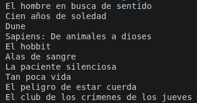

4. Seleccionar todos los identificadores id.

  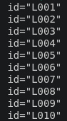

5. Seleccionar todos los géneros, aunque se repitan.

  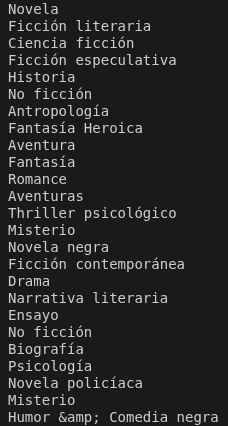

6. Seleccionar un libro mediante un identificador concreto.

   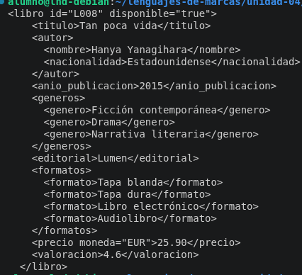

7. Seleccionar los títulos de los libros disponibles.

  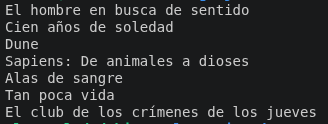

8. Seleccionar los libros de un género determinado que te guste.

  ```XML
  <libro id="L005" disponible="false">
    <titulo>El hobbit</titulo>
    <autor>
      <nombre>J.R.R. Tolkien</nombre>
      <nacionalidad>Británico</nacionalidad>
    </autor>
    <anio_publicacion>1937</anio_publicacion>
    <generos>
      <genero>Fantasía Heroica</genero>
      <genero>Aventura</genero>
    </generos>
    <editorial>Minotauro</editorial>
    <formatos>
      <formato>Tapa blanda</formato>
      <formato>Tapa dura</formato>
      <formato>Edición ilustrada</formato>
      <formato>Libro electrónico</formato>
      <formato>Audiolibro</formato>
    </formatos>
    <precio moneda="EUR">21.00</precio>
    <valoracion>4.8</valoracion>
    <saga>Precuela de El Señor de los Anillos</saga>
  </libro>
<libro id="L006" disponible="true">
    <titulo>Alas de sangre</titulo>
    <autor>
      <nombre>Rebecca Yarros</nombre>
      <nacionalidad>Estadounidense</nacionalidad>
    </autor>
    <anio_publicacion>2023</anio_publicacion>
    <generos>
      <genero>Fantasía</genero>
      <genero>Romance</genero>
      <genero>Aventuras</genero>
    </generos>
    <editorial>Editorial Planeta</editorial>
    <formatos>
      <formato>Tapa blanda</formato>
      <formato>Tapa dura con jaspeado</formato>
      <formato>Libro electrónico</formato>
      <formato>Audiolibro</formato>
    </formatos>
    <precio moneda="EUR">22.90</precio>
    <valoracion>4.7</valoracion>
    <saga>Serie Empíreo</saga>
  </libro>
  ```

9. Seleccionar los libros publicados desde 2020, incluido.

```XML
<libro id="L006" disponible="true">
    <titulo>Alas de sangre</titulo>
    <autor>
      <nombre>Rebecca Yarros</nombre>
      <nacionalidad>Estadounidense</nacionalidad>
    </autor>
    <anio_publicacion>2023</anio_publicacion>
    <generos>
      <genero>Fantasía</genero>
      <genero>Romance</genero>
      <genero>Aventuras</genero>
    </generos>
    <editorial>Editorial Planeta</editorial>
    <formatos>
      <formato>Tapa blanda</formato>
      <formato>Tapa dura con jaspeado</formato>
      <formato>Libro electrónico</formato>
      <formato>Audiolibro</formato>
    </formatos>
    <precio moneda="EUR">22.90</precio>
    <valoracion>4.7</valoracion>
    <saga>Serie Empíreo</saga>
  </libro>
<libro id="L009" disponible="false">
    <titulo>El peligro de estar cuerda</titulo>
    <autor>
      <nombre>Rosa Montero</nombre>
      <nacionalidad>Española</nacionalidad>
    </autor>
    <anio_publicacion>2022</anio_publicacion>
    <generos>
      <genero>Ensayo</genero>
      <genero>No ficción</genero>
      <genero>Biografía</genero>
      <genero>Psicología</genero>
    </generos>
    <editorial>Seix Barral</editorial>
    <formatos>
      <formato>Tapa blanda</formato>
      <formato>Libro electrónico</formato>
      <formato>Audiolibro</formato>
    </formatos>
    <precio moneda="EUR">20.90</precio>
    <valoracion>4.5</valoracion>
  </libro>
<libro id="L010" disponible="true">
    <titulo>El club de los crímenes de los jueves</titulo>
    <autor>
      <nombre>Richard Osman</nombre>
      <nacionalidad>Británico</nacionalidad>
    </autor>
    <anio_publicacion>2020</anio_publicacion>
    <generos>
      <genero>Novela policíaca</genero>
      <genero>Misterio</genero>
      <genero>Humor &amp; Comedia negra</genero>
    </generos>
    <editorial>Espasa </editorial>
    <formatos>
      <formato>Tapa blanda</formato>
      <formato>Libro electrónico</formato>
      <formato>Audiolibro</formato>
    </formatos>
    <precio moneda="EUR">19.90</precio>
    <valoracion>4.3</valoracion>
    <saga>El club de los crímenes de los jueves</saga>
  </libro>
  ```

10. Seleccionar los libros disponibles cuyo precio sea inferior a 20 euros.

```XML
<libro id="L001" disponible="true">
    <titulo>El hombre en busca de sentido</titulo>
    <autor>
      <nombre>Viktor Frankl</nombre>
      <nacionalidad>Austriaco</nacionalidad>
    </autor>
    <anio_publicacion>1946</anio_publicacion>
    <generos>
      <genero>Biografía</genero>
      <genero>Psicología</genero>
      <genero>Filosofía</genero>
      <genero>Ensayo</genero>
    </generos>
    <editorial>Herder Editorial</editorial>
    <formatos>
      <formato>Tapa blanda</formato>
      <formato>Tapa dura</formato>
      <formato>Libro electrónico</formato>
      <formato>Audiolibro</formato>
    </formatos>
    <precio moneda="EUR">12.90</precio>
    <valoracion>4.8</valoracion>
  </libro>
<libro id="L003" disponible="true">
    <titulo>Dune</titulo>
    <autor>
      <nombre>Frank Herbert</nombre>
      <nacionalidad>Estadounidense</nacionalidad>
    </autor>
    <anio_publicacion>1965</anio_publicacion>
    <generos>
      <genero>Ciencia ficción</genero>
      <genero>Ficción especulativa</genero>
    </generos>
    <editorial>Nova</editorial>
    <formatos>
      <formato>Tapa blanda</formato>
      <formato>Tapa dura</formato>
      <formato>Libro electrónico</formato>
      <formato>Audiolibro</formato>
    </formatos>
    <precio moneda="EUR">14.90</precio>
    <valoracion>4.6</valoracion>
    <saga>Las crónicas de Dune</saga>
  </libro>
<libro id="L010" disponible="true">
    <titulo>El club de los crímenes de los jueves</titulo>
    <autor>
      <nombre>Richard Osman</nombre>
      <nacionalidad>Británico</nacionalidad>
    </autor>
    <anio_publicacion>2020</anio_publicacion>
    <generos>
      <genero>Novela policíaca</genero>
      <genero>Misterio</genero>
      <genero>Humor &amp; Comedia negra</genero>
    </generos>
    <editorial>Espasa </editorial>
    <formatos>
      <formato>Tapa blanda</formato>
      <formato>Libro electrónico</formato>
      <formato>Audiolibro</formato>
    </formatos>
    <precio moneda="EUR">19.90</precio>
    <valoracion>4.3</valoracion>
    <saga>El club de los crímenes de los jueves</saga>
  </libro>
```
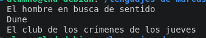

11. Seleccionar los libros pertenecientes a uno de dos géneros utilizando or.

```XML
<libro id="L003" disponible="true">
    <titulo>Dune</titulo>
    <autor>
      <nombre>Frank Herbert</nombre>
      <nacionalidad>Estadounidense</nacionalidad>
    </autor>
    <anio_publicacion>1965</anio_publicacion>
    <generos>
      <genero>Ciencia ficción</genero>
      <genero>Ficción especulativa</genero>
    </generos>
    <editorial>Nova</editorial>
    <formatos>
      <formato>Tapa blanda</formato>
      <formato>Tapa dura</formato>
      <formato>Libro electrónico</formato>
      <formato>Audiolibro</formato>
    </formatos>
    <precio moneda="EUR">14.90</precio>
    <valoracion>4.6</valoracion>
    <saga>Las crónicas de Dune</saga>
  </libro>
<libro id="L005" disponible="false">
    <titulo>El hobbit</titulo>
    <autor>
      <nombre>J.R.R. Tolkien</nombre>
      <nacionalidad>Británico</nacionalidad>
    </autor>
    <anio_publicacion>1937</anio_publicacion>
    <generos>
      <genero>Fantasía Heroica</genero>
      <genero>Aventura</genero>
    </generos>
    <editorial>Minotauro</editorial>
    <formatos>
      <formato>Tapa blanda</formato>
      <formato>Tapa dura</formato>
      <formato>Edición ilustrada</formato>
      <formato>Libro electrónico</formato>
      <formato>Audiolibro</formato>
    </formatos>
    <precio moneda="EUR">21.00</precio>
    <valoracion>4.8</valoracion>
    <saga>Precuela de El Señor de los Anillos</saga>
  </libro>
<libro id="L006" disponible="true">
    <titulo>Alas de sangre</titulo>
    <autor>
      <nombre>Rebecca Yarros</nombre>
      <nacionalidad>Estadounidense</nacionalidad>
    </autor>
    <anio_publicacion>2023</anio_publicacion>
    <generos>
      <genero>Fantasía</genero>
      <genero>Romance</genero>
      <genero>Aventuras</genero>
    </generos>
    <editorial>Editorial Planeta</editorial>
    <formatos>
      <formato>Tapa blanda</formato>
      <formato>Tapa dura con jaspeado</formato>
      <formato>Libro electrónico</formato>
      <formato>Audiolibro</formato>
    </formatos>
    <precio moneda="EUR">22.90</precio>
    <valoracion>4.7</valoracion>
    <saga>Serie Empíreo</saga>
  </libro>
<libro id="L008" disponible="true">
    <titulo>Tan poca vida</titulo>
    <autor>
      <nombre>Hanya Yanagihara</nombre>
      <nacionalidad>Estadounidense</nacionalidad>
    </autor>
    <anio_publicacion>2015</anio_publicacion>
    <generos>
      <genero>Ficción contemporánea</genero>
      <genero>Drama</genero>
      <genero>Narrativa literaria</genero>
    </generos>
    <editorial>Lumen</editorial>
    <formatos>
      <formato>Tapa blanda</formato>
      <formato>Tapa dura</formato>
      <formato>Libro electrónico</formato>
      <formato>Audiolibro</formato>
    </formatos>
    <precio moneda="EUR">25.90</precio>
    <valoracion>4.6</valoracion>
  </libro>
```

12. Seleccionar los libros que no tengan el elemento opcional <saga>.

```XML
<libro id="L001" disponible="true">
    <titulo>El hombre en busca de sentido</titulo>
    <autor>
      <nombre>Viktor Frankl</nombre>
      <nacionalidad>Austriaco</nacionalidad>
    </autor>
    <anio_publicacion>1946</anio_publicacion>
    <generos>
      <genero>Biografía</genero>
      <genero>Psicología</genero>
      <genero>Filosofía</genero>
      <genero>Ensayo</genero>
    </generos>
    <editorial>Herder Editorial</editorial>
    <formatos>
      <formato>Tapa blanda</formato>
      <formato>Tapa dura</formato>
      <formato>Libro electrónico</formato>
      <formato>Audiolibro</formato>
    </formatos>
    <precio moneda="EUR">12.90</precio>
    <valoracion>4.8</valoracion>
  </libro>
<libro id="L002" disponible="true">
    <titulo>Cien años de soledad</titulo>
    <autor>
      <nombre>Gabriel García Márquez</nombre>
      <nacionalidad>Colombiano</nacionalidad>
    </autor>
    <anio_publicacion>1967</anio_publicacion>
    <generos>
      <genero>Realismo mágico</genero>
      <genero>Novela</genero>
      <genero>Ficción literaria</genero>
    </generos>
    <editorial>Literatura Random House</editorial>
    <formatos>
      <formato>Tapa blanda</formato>
      <formato>Edición ilustrada</formato>
      <formato>Libro electrónico</formato>
      <formato>Audiolibro</formato>
    </formatos>
    <precio moneda="EUR">21.90</precio>
    <valoracion>4.7</valoracion>
  </libro>
<libro id="L004" disponible="true">
    <titulo>Sapiens: De animales a dioses</titulo>
    <autor>
      <nombre>Yuval Noah Harari</nombre>
      <nacionalidad>Israelí</nacionalidad>
    </autor>
    <anio_publicacion>2011</anio_publicacion>
    <generos>
      <genero>Historia</genero>
      <genero>No ficción</genero>
      <genero>Antropología</genero>
    </generos>
    <editorial>Debate</editorial>
    <formatos>
      <formato>Tapa blanda</formato>
      <formato>Cómic / Novela gráfica</formato>
      <formato>Libro electrónico</formato>
      <formato>Audiolibro</formato>
    </formatos>
    <precio moneda="EUR">23.90</precio>
    <valoracion>4.7</valoracion>
  </libro>
<libro id="L007" disponible="false">
    <titulo>La paciente silenciosa</titulo>
    <autor>
      <nombre>Alex Michaelides</nombre>
      <nacionalidad>Chipriota / Británico</nacionalidad>
    </autor>
    <anio_publicacion>2019</anio_publicacion>
    <generos>
      <genero>Thriller psicológico</genero>
      <genero>Misterio</genero>
      <genero>Novela negra</genero>
    </generos>
    <editorial>Alfaguara </editorial>
    <formatos>
      <formato>Tapa blanda</formato>
      <formato>Libro electrónico</formato>
      <formato>Audiolibro</formato>
    </formatos>
    <precio moneda="EUR">21.90</precio>
    <valoracion>4.4</valoracion>
  </libro>
<libro id="L008" disponible="true">
    <titulo>Tan poca vida</titulo>
    <autor>
      <nombre>Hanya Yanagihara</nombre>
      <nacionalidad>Estadounidense</nacionalidad>
    </autor>
    <anio_publicacion>2015</anio_publicacion>
    <generos>
      <genero>Ficción contemporánea</genero>
      <genero>Drama</genero>
      <genero>Narrativa literaria</genero>
    </generos>
    <editorial>Lumen</editorial>
    <formatos>
      <formato>Tapa blanda</formato>
      <formato>Tapa dura</formato>
      <formato>Libro electrónico</formato>
      <formato>Audiolibro</formato>
    </formatos>
    <precio moneda="EUR">25.90</precio>
    <valoracion>4.6</valoracion>
  </libro>
<libro id="L009" disponible="false">
    <titulo>El peligro de estar cuerda</titulo>
    <autor>
      <nombre>Rosa Montero</nombre>
      <nacionalidad>Española</nacionalidad>
    </autor>
    <anio_publicacion>2022</anio_publicacion>
    <generos>
      <genero>Ensayo</genero>
      <genero>No ficción</genero>
      <genero>Biografía</genero>
      <genero>Psicología</genero>
    </generos>
    <editorial>Seix Barral</editorial>
    <formatos>
      <formato>Tapa blanda</formato>
      <formato>Libro electrónico</formato>
      <formato>Audiolibro</formato>
    </formatos>
    <precio moneda="EUR">20.90</precio>
    <valoracion>4.5</valoracion>
  </libro>
```

13. Seleccionar el primer y el último libro.

```XML
<libro id="L001" disponible="true">
    <titulo>El hombre en busca de sentido</titulo>
    <autor>
      <nombre>Viktor Frankl</nombre>
      <nacionalidad>Austriaco</nacionalidad>
    </autor>
    <anio_publicacion>1946</anio_publicacion>
    <generos>
      <genero>Biografía</genero>
      <genero>Psicología</genero>
      <genero>Filosofía</genero>
      <genero>Ensayo</genero>
    </generos>
    <editorial>Herder Editorial</editorial>
    <formatos>
      <formato>Tapa blanda</formato>
      <formato>Tapa dura</formato>
      <formato>Libro electrónico</formato>
      <formato>Audiolibro</formato>
    </formatos>
    <precio moneda="EUR">12.90</precio>
    <valoracion>4.8</valoracion>
  </libro>
<libro id="L010" disponible="true">
    <titulo>El club de los crímenes de los jueves</titulo>
    <autor>
      <nombre>Richard Osman</nombre>
      <nacionalidad>Británico</nacionalidad>
    </autor>
    <anio_publicacion>2020</anio_publicacion>
    <generos>
      <genero>Novela policíaca</genero>
      <genero>Misterio</genero>
      <genero>Humor &amp; Comedia negra</genero>
    </generos>
    <editorial>Espasa </editorial>
    <formatos>
      <formato>Tapa blanda</formato>
      <formato>Libro electrónico</formato>
      <formato>Audiolibro</formato>
    </formatos>
    <precio moneda="EUR">19.90</precio>
    <valoracion>4.3</valoracion>
    <saga>El club de los crímenes de los jueves</saga>
  </libro>
```

14. Seleccionar los tres primeros libros del catálogo.

```XML
<libro id="L001" disponible="true">
    <titulo>El hombre en busca de sentido</titulo>
    <autor>
      <nombre>Viktor Frankl</nombre>
      <nacionalidad>Austriaco</nacionalidad>
    </autor>
    <anio_publicacion>1946</anio_publicacion>
    <generos>
      <genero>Biografía</genero>
      <genero>Psicología</genero>
      <genero>Filosofía</genero>
      <genero>Ensayo</genero>
    </generos>
    <editorial>Herder Editorial</editorial>
    <formatos>
      <formato>Tapa blanda</formato>
      <formato>Tapa dura</formato>
      <formato>Libro electrónico</formato>
      <formato>Audiolibro</formato>
    </formatos>
    <precio moneda="EUR">12.90</precio>
    <valoracion>4.8</valoracion>
  </libro>
<libro id="L002" disponible="true">
    <titulo>Cien años de soledad</titulo>
    <autor>
      <nombre>Gabriel García Márquez</nombre>
      <nacionalidad>Colombiano</nacionalidad>
    </autor>
    <anio_publicacion>1967</anio_publicacion>
    <generos>
      <genero>Realismo mágico</genero>
      <genero>Novela</genero>
      <genero>Ficción literaria</genero>
    </generos>
    <editorial>Literatura Random House</editorial>
    <formatos>
      <formato>Tapa blanda</formato>
      <formato>Edición ilustrada</formato>
      <formato>Libro electrónico</formato>
      <formato>Audiolibro</formato>
    </formatos>
    <precio moneda="EUR">21.90</precio>
    <valoracion>4.7</valoracion>
  </libro>
<libro id="L003" disponible="true">
    <titulo>Dune</titulo>
    <autor>
      <nombre>Frank Herbert</nombre>
      <nacionalidad>Estadounidense</nacionalidad>
    </autor>
    <anio_publicacion>1965</anio_publicacion>
    <generos>
      <genero>Ciencia ficción</genero>
      <genero>Ficción especulativa</genero>
    </generos>
    <editorial>Nova</editorial>
    <formatos>
      <formato>Tapa blanda</formato>
      <formato>Tapa dura</formato>
      <formato>Libro electrónico</formato>
      <formato>Audiolibro</formato>
    </formatos>
    <precio moneda="EUR">14.90</precio>
    <valoracion>4.6</valoracion>
    <saga>Las crónicas de Dune</saga>
  </libro>
```
15. Contar el número total de libros.

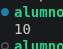

16. Contar cuántos libros pertenecen a un género concreto.

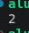

17. Buscar títulos que contengan una palabra mediante contains().

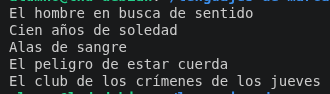

18. Calcular el precio medio utilizando sum(), count() y div.

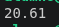

19. Partir de un elemento <genero> y utilizar ancestor::libro para obtener el título de su libro.

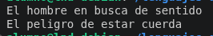

20. Partir de <titulo> y utilizar following-sibling para seleccionar el elemento <autor> del mismo libro.

```XML
<autor>
      <nombre>Viktor Frankl</nombre>
      <nacionalidad>Austriaco</nacionalidad>
    </autor>
<autor>
      <nombre>Gabriel García Márquez</nombre>
      <nacionalidad>Colombiano</nacionalidad>
    </autor>
<autor>
      <nombre>Frank Herbert</nombre>
      <nacionalidad>Estadounidense</nacionalidad>
    </autor>
<autor>
      <nombre>Yuval Noah Harari</nombre>
      <nacionalidad>Israelí</nacionalidad>
    </autor>
<autor>
      <nombre>J.R.R. Tolkien</nombre>
      <nacionalidad>Británico</nacionalidad>
    </autor>
<autor>
      <nombre>Rebecca Yarros</nombre>
      <nacionalidad>Estadounidense</nacionalidad>
    </autor>
<autor>
      <nombre>Alex Michaelides</nombre>
      <nacionalidad>Chipriota / Británico</nacionalidad>
    </autor>
<autor>
      <nombre>Hanya Yanagihara</nombre>
      <nacionalidad>Estadounidense</nacionalidad>
    </autor>
<autor>
      <nombre>Rosa Montero</nombre>
      <nacionalidad>Española</nacionalidad>
    </autor>
<autor>
      <nombre>Richard Osman</nombre>
      <nacionalidad>Británico</nacionalidad>
    </autor>
```

21. APARTADO DE PROBLEMAS ENCONTRADOS Y SOLUCIONES APLICADAS

```BASH
xmllint --xpath '//libro[@disponible= 'true']' biblioteca.xml
```
Al usar las comillas simples otra vez para darle un valor a disponible la máquina entendía que ahí acababa la consulta y me saltaba un fallo, hay que usar las comillas dobles ("") para asignar un valor.